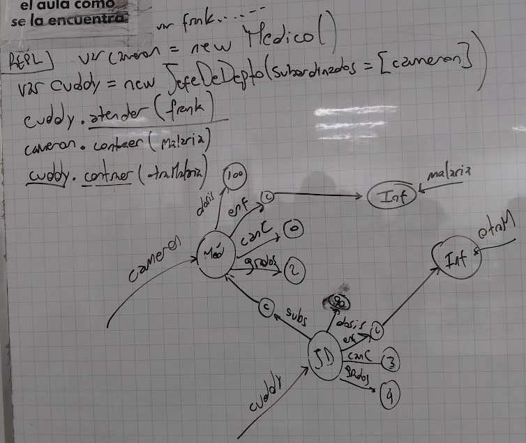
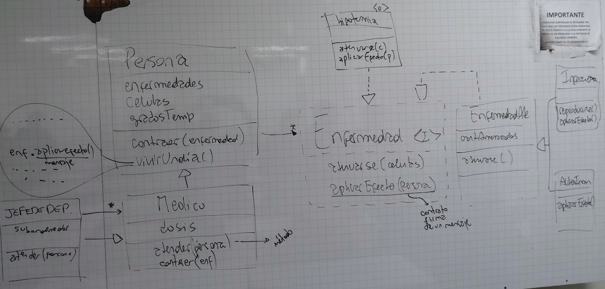

# Clase 22 - Super y redefinicion

Fecha: 27/10/2026

Hoy completamos el enunciado de "Dr Casa"

### Materiales que dan soporte a los temas de hoy

- [Terminamos el Enunciado](https://github.com/pdepman/2026-o-repaso-clases/blob/main/Dr%20Casa%20Temporadas%201%20y%202%20-%20Wollok.pdf)
- Código [Hecho en clase](https://github.com/pdepman/2026-o-repaso-clases)

### Apuntes
  - [Herencia](https://docs.google.com/document/d/1KdG7NrKPgPh4bAcyLuDG2G1iWP7Ze2GFs91qzlvDKqI/edit?tab=t.0)
  - [Diagramas](https://docs.google.com/document/d/1eXLlNppAX-7E2M8Xxs0MCckdn4XVEYmeQNaS_E1RqTc/edit?tab=t.0) (Guía para comunicar un diseño)
