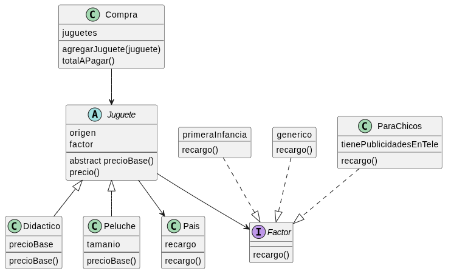

# Clase 21 - Repaso y Composición

Fecha: 03/11/2026

Hoy hicimos **paro activo**

Es decir, hablamos un poco sobre la situación de incumplimiento de la ley de educación y además hicimos un repaso.

### Materiales que dan soporte a los temas de hoy

- [:film_strip: Video de la clase](https://drive.google.com/file/d/1qqBH6QG2SC0OBq2-PA4n9Dg-WZMi1gPM/view?usp=sharing)
- [:computer: Código de la clase](https://github.com/pdepman/2026-o-repaso)
